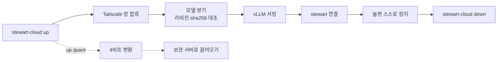

# stewart-cloud

[](LICENSE)
[](#준비물)
[](#준비물)
[](https://vast.ai)
[](https://github.com/vllm-project/vllm)
[](https://github.com/midopa-dept/stewart-cloud/actions/workflows/tests.yml)

[Source](https://github.com/midopa-dept/stewart-cloud) · [Issues](https://github.com/midopa-dept/stewart-cloud/issues)

**Vast.ai 에서 GPU 를 빌려 열린 모델을 vLLM 으로 띄우고, 내 Tailscale 망에서만 닿게 하는 도구입니다.**

Rent a GPU on Vast.ai, serve an open model with vLLM, and reach it only from your own Tailscale network.

Python · Vast.ai · vLLM · Tailscale · macOS

한국어 · [English](README.en.md) · [stewart](https://github.com/midopa-dept/stewart)



내 GPU 없이, 인터넷에 포트를 열지 않고 큰 열린 모델을 몇 시간 쓰고 싶을 때 씁니다. 인스턴스가 돌리거나 받는 파일은 모두 해시로 고정되고, 인스턴스는 놀거나 부팅에 실패하면 스스로 멈춥니다. 그래서 끄는 것을 잊은 대여가 계속 돌지 않습니다. [stewart](https://github.com/midopa-dept/stewart) 를 위해 만들었지만, OpenAI 호환 클라이언트라면 무엇이든 이 서버를 쓸 수 있습니다.

## 무엇인가

- `stewart_cloud/` — `stewart-cloud` 명령입니다. offer 를 찾고, 빌리고, 상태를 보고, 로그를 읽고, 인스턴스를 지웁니다. git 커밋에서 파드 묶음을 다시 만들어 대조하고(`verify`), 비밀 gist 에 올려 고정한 Vast 템플릿을 만듭니다(`publish`).
- `deploy/vast/` — 인스턴스가 켜질 때 도는 파드 묶음입니다. 테일넷에 붙고, 모델을 받고, vLLM 을 띄우고, 노는 시간을 지켜봅니다.
- `deploy/serving/` — 모델 표, 컨테이너 이미지 두 가지(HyperQwen·공식 vLLM 이미지)용 어댑터, vLLM 0.30.0 패치 묶음과 그 검사기입니다. 검사기는 패치를 정확히 덧대거나, 그러지 못하면 멈춥니다.
- `deploy/quant/`(선택) — 빌린 A100·H100 에서 BF16 체크포인트를 AutoRound W4A16 으로 바꾸고, 바꾸기 앞뒤의 KL 발산을 잽니다.
- `deploy/modelstore/`(선택) — 내 Linux 서버에 모델을 두고 Tailscale 로 파드에 밀어 넣습니다. 파드는 내 서버로 연결을 열지 못합니다.

모델 가중치는 배포하지 않습니다. 공개 모델 표에는 Qwen3.8-27B 의 W4A16 변환 줄 하나만 있고, 직접 변환하기 전에는 고를 수 없습니다([모델 변환](#모델-변환) 참고).

## 준비물

- Mac. 키는 `/usr/bin/security` 로 로그인 키체인에서 읽고, `verify` 는 묶음 빌더를 `sandbox-exec` 안에서 돌립니다.
- 명령을 돌릴 `/usr/bin/python3`(Command Line Tools), 시험과 묶음 빌더에 쓸 [uv](https://docs.astral.sh/uv/) 와 CPython 3.13.
- 선불 크레딧이 있는 Vast.ai 계정과 API 키 두 개:
  - 빌리기용 키: misc, instance_read, instance_write
  - 템플릿용 키: user_read, user_write
- Tailscale 계정.
- GitHub 계정과 fine-grained 토큰. 권한은 Account permissions → Gists(read·write) 하나만 줍니다.
- `deploy/modelstore` 를 쓰면: 같은 테일넷에 있는 systemd Linux 서버.

대여는 인스턴스가 켜져 있는 동안 시간 단위로 돈이 나갑니다. 정지한 인스턴스도 지우기 전까지 디스크 요금이 나갑니다. RTX 3090 한 장으로 저녁 한때 쓰면 1달러 안팎이고, A100 에서 모델 셋을 변환하면 10달러쯤 듭니다. [비용 어림](#비용-어림)을 참고합니다.

## 설치와 준비

### 1. Vast.ai

1. 선불 크레딧을 넣고 자동 충전을 끕니다. 그러면 잔액이 지출 상한이 됩니다. stewart-cloud 는 빌리기 전에 잔액을 따지지 않습니다(`balance` 로 보기만 합니다).
2. 위의 API 키 두 개를 만듭니다. user_write 는 API 키와 계정 환경 변수 만들기까지 포함하므로 두 키를 나눠 둡니다. 템플릿용 키를 만들지 않으면 빌리기용 키에도 user_read·user_write 가 있어야 합니다.
3. 계정 설정의 환경 변수에 `TS_AUTHKEY` 를 넣습니다(값은 다음 절에서 만드는 Tailscale 키). 파드는 다른 것을 띄우기 전에 이 값을 `/dev/shm` 의 600 파일로 옮기고 환경에서 지웁니다. 이 값은 이 저장소·템플릿·명령줄 어디에도 나오지 않습니다.

### 2. Tailscale

1. ACL 정책에 태그 `tag:gpu` 를 만듭니다. 내 기기는 `tag:gpu` 의 서빙 포트(8000, 평가 인스턴스의 차선 포트 80k0, 상태 포트 8001)로만 가게 합니다. `tag:gpu` 에서는 아무 데로도 못 가게 합니다. 모델 보관소를 쓰면 내 서버에서 파드의 받는 포트로 가는 길만 엽니다.
2. 그 태그로 인증 키를 만듭니다. 재사용 가능·임시(ephemeral)·사전 승인으로 만듭니다.
3. 역할마다 노드 이름이 정해져 있습니다.

   | 역할 | 노드 이름 | 쓰임 |
   |---|---|---|
   | serve | `stewart-gpu` | 사람이 쓰는 서빙 1장 |
   | eval, eval2 | `stewart-gpu-eval`, `stewart-gpu-eval2` | 여러 장, 차선마다 모델 하나 |
   | quant | `stewart-quant` | 모델 변환 |

   설정 파일에는 `<이름>.<내 테일넷>.ts.net` 꼴로 적습니다.

### 3. gist

1. 묶음을 둘 비밀 gist 를 만듭니다. `publish` 가 여기에 `stewart-pod-v2.b64` 같은 파일을 더합니다.
2. 파드 설정 파일을 둘 비밀 gist 를 하나 더 만듭니다. 파드는 아래 키만 읽고 나머지 줄은 버립니다.

   ```
   CTX=long
   SPEC=mtp
   PREFIX_CACHE=1
   QUALITY=auto
   MODEL=<모델 표의 별칭>
   ADAPTER=auto
   ```

   쓸 수 있는 값: `CTX` fast·long, `SPEC` mtp, `PREFIX_CACHE` 0·1, `FAST_VARIANT` 0·1, `QUALITY` auto·0·1, `ADAPTER` auto·hyperqwen-8cf642e·vllm-patched·vllm-stock, `MODEL`·`PLAN` 은 소문자·숫자·`.`·`-` 48자까지.
3. 준비물에 적은 GitHub 토큰을 만듭니다.

### 4. 설치

설치 폴더는 root 소유여야 합니다. 그래야 내 사용자로 도는 다른 프로그램(AI 에이전트 포함)이 코드·설정·상태를 바꾸지 못합니다. 기본 위치는 `/opt/stewart-cloud` 입니다(`stewart_cloud.py` 의 `PREFIX`).

```bash
git clone https://github.com/midopa-dept/stewart-cloud ~/src/stewart-cloud
cd ~/src/stewart-cloud
uv run --no-project --offline --python 3.13 python -m unittest discover -s tests -t .
```

시험은 망·키체인·GPU 없이 돕니다. 다 통과하면 설치합니다.

```bash
sudo install -d -o root -g wheel -m 755 /opt/stewart-cloud /opt/stewart-cloud/bin
sudo install -o root -g wheel -m 644 stewart_cloud/stewart_cloud.py /opt/stewart-cloud/stewart_cloud.py
sudo install -o root -g wheel -m 755 stewart_cloud/stewart-cloud /opt/stewart-cloud/bin/stewart-cloud
sudo install -o root -g wheel -m 644 stewart_cloud/config.example.json /opt/stewart-cloud/config.json
sudo install -d -o "$USER" -g staff -m 700 /opt/stewart-cloud/state
```

- `config.json` 의 `ts_name` 넷을 내 테일넷 이름으로 바꾸고, 역할마다 `max_dph`(시간당 값 상한)와 `disk` 를 봅니다. 코드에도 넘을 수 없는 상한이 있습니다(인스턴스 하나에 8.0 $/hr, 8장).
- `site.json` 은 선택입니다. 키체인 계정·홈 폴더·기록 폴더·저장소·묶음 폴더를 바꿀 때만 둡니다. 없으면 부른 사용자와 그 홈 아래 경로를 씁니다. 견본은 `stewart_cloud/site.example.json` 입니다.
- `verify`·`publish` 를 쓰려면 uv 의 CPython 3.13 을 `/opt/stewart-cloud/py313/` 로 복사하고, root 소유에 그룹·남이 쓸 수 없게 둡니다. 묶음은 3.13 으로 다시 만들어야 합니다. 다른 판은 바이트가 달라 해시가 바뀝니다.

### 5. 키

키는 로그인 키체인에 generic password 로 둡니다. 계정은 내 사용자 이름이고, `/usr/bin/security` 가 읽을 수 있게 합니다. `-w` 를 값 없이 주면 화면에 보이지 않게 값을 묻습니다.

```bash
security add-generic-password -s stewart-cloud.vast-api -a "$USER" -T /usr/bin/security -w
security add-generic-password -s stewart-cloud.vast-template -a "$USER" -T /usr/bin/security -w
security add-generic-password -s stewart-cloud.github-gist -a "$USER" -T /usr/bin/security -w
```

빌리기용 키가 맞는지 봅니다. `stewart- 인스턴스 0개` 가 나오면 맞습니다.

```bash
/opt/stewart-cloud/bin/stewart-cloud status
```

키는 환경 변수·명령줄·파일로 넘기지 않습니다. 명령이 `security` 를 직접 부르고, 출력을 파이프로만 받고, HTTP Authorization 헤더에만 넣습니다. SSH 로 들어오면 키체인이 잠겨 있어 종료 코드 78 이 납니다. 먼저 `security unlock-keychain ~/Library/Keychains/login.keychain-db` 를 칩니다.

### 6. 첫 템플릿

`publish` 는 지금 템플릿에서 이미지·디스크 크기·Args 꼴을 베낍니다. 그래서 첫 템플릿 하나는 손으로 만듭니다.

1. 묶음을 만듭니다.

   ```bash
   uv run --no-project --python 3.13 python deploy/vast/make_template_env.py --out ~/.local/share/stewart-cloud/bundles/v1
   ```

   폴더에 `pod-files.b64`·`args.txt`·`boot.sb.txt`·`docker-options.txt` 가 생깁니다. 원본이 같으면 바이트도 늘 같습니다.
2. `pod-files.b64` 를 묶음 gist 에 올리고, 그 리비전에 고정한 raw 주소를 복사합니다.
3. Vast 콘솔에서 비공개 템플릿을 만듭니다.
   - 이미지: `deploy/serving/models.toml` 의 `[images.*].ref`(digest 고정)
   - 실행 방식: Entrypoint, Args 는 `args.txt` 내용 그대로
   - Docker Options: `docker-options.txt` 내용에서 `<gist raw 주소>` 를 묶음 주소로, `<설정 gist 최신 raw 주소>` 를 설정 gist 의 최신 raw 주소로 바꾼 것
4. `stewart_cloud/state-seed.example.json` 의 빈칸(템플릿 hash_id, 묶음 해시 `PS`, `boot.sb.txt`·`args.txt` 의 sha256)을 채워 상태 파일로 넣고 확인합니다.

   ```bash
   cp stewart_cloud/state-seed.example.json /opt/stewart-cloud/state/templates.json   # 빈칸을 채운 뒤에
   chmod 600 /opt/stewart-cloud/state/templates.json
   /opt/stewart-cloud/bin/stewart-cloud templates
   ```

변환을 쓰려면 `deploy/quant/make_quant_bundle.py` 로 같은 일을 한 번 더 하고 `current.quant` 를 더합니다.

### 7. 묶음 바꾸기

`deploy/` 를 고쳐 커밋한 뒤, 새 폴더에 묶음을 만들고 대조한 다음 올립니다.

```bash
uv run --no-project --python 3.13 python deploy/vast/make_template_env.py --out ~/.local/share/stewart-cloud/bundles/v2
/opt/stewart-cloud/bin/stewart-cloud verify v2 <커밋 40자> <PS 64자>
/opt/stewart-cloud/bin/stewart-cloud publish v2 <커밋 40자> <PS 64자>
```

- `verify` 는 키도 망도 쓰지 않습니다. git 객체를 직접 읽어 SHA-1 을 하나하나 다시 셈하고, `.git/config` 의 filter 는 거치지 않습니다. `deploy/` 를 빈 폴더에 꺼내 망이 없는 `sandbox-exec` 안에서 빌더를 돌립니다. 결과가 묶음 폴더와 바이트로 같고 해시가 `PS` 와 같을 때만 통과합니다.
- `publish` 는 `verify` 를 다시 하고 묶음을 gist 에 더합니다. 고정 주소를 토큰 없이 받아 `PS` 와 견주고, 새 템플릿을 만들어 다시 읽습니다. 모든 칸이 맞을 때만 지금 템플릿을 바꿉니다.
- 되돌리려면 옛 묶음을 다시 publish 합니다.

## 빌리고 띄우기

```bash
/opt/stewart-cloud/bin/stewart-cloud offers serve
/opt/stewart-cloud/bin/stewart-cloud up serve <offer_id> <시간당 최대 달러>
/opt/stewart-cloud/bin/stewart-cloud status
/opt/stewart-cloud/bin/stewart-cloud logs <instance_id>
```

- `offers` 는 조건에 맞는 offer 를 장당 값이 싼 순서로 보이고, 칠 `up` 명령을 함께 보입니다.
- `up` 은 같은 검색을 다시 해서 offer 와 값을 한 번 더 봅니다. 역할마다 하나만 빌리고, 그 역할의 노드 이름이 아직 테일넷에 있으면 빌리지 않습니다. 같은 역할의 정지한 인스턴스는 먼저 지웁니다. 정지한 것을 남겨 두고 하나 더 빌리려면 `up-keep <역할> <offer_id> <시간당 최대 달러> <디스크 GB>` 를 씁니다(같은 역할이 켜져 있으면 거부).
- `up` 은 지금 템플릿을 API 로 다시 읽어, 묶음 해시·boot 스크립트 해시·Args 가 `publish` 기록과 같을 때만 빌립니다.
- `status` 는 켜진 시간, 지금까지의 값, 쉬다 정지까지 남은 시간, 모델 받기 진행, 실패한 차선과 부팅 오류를 보입니다.
- 평가에는 `up eval <offer_id> <시간당 최대 달러> <계획>` 으로 모델 표의 `plans` 에서 계획을 고릅니다.
- `balance` 는 계정 잔액 칸 둘과 켜진 인스턴스의 시간당 합을 보입니다. 읽기만 하고 빌리기를 막지는 않습니다(키에 user_read 가 있어야 합니다).
- 기본 조건은 모든 역할이 datacenter·verified·신뢰도 ≥ `reliability_min` 입니다. 평가만 개인 호스트도 쓰려면 `config.json` 의 `roles.eval` 에 `"nondc_reliability_min": 0.98` 처럼 적습니다(eval2 도 따릅니다).
  - 그러면 eval 검색은 datacenter 조건 없이 한 번, datacenter 로 한 번 해서 합칩니다.
  - datacenter 인 offer 는 지금 조건 그대로입니다. 아닌 offer 는 verified 이고 신뢰도가 이 값 이상일 때만 빌립니다.
  - `offers` 줄에 `is_datacenter`·`hosting_type` 이 나오고, `up` 기록에 기계 번호·위치·신뢰도·GPU 가 남습니다.
  - 개인 호스트도 datacenter 처럼 컨테이너 안의 키·모델·요청 글을 볼 수 있습니다. 바뀌는 것은 호스트를 고르는 심사입니다. 실험 뒤 Tailscale 키와 HF 읽기 토큰을 바꾸는 것을 권합니다.

### 모델 고르기

파드는 설정 gist 의 `MODEL=<별칭>` 으로 모델 표의 줄 하나를 고릅니다. 저장소·리비전·파일 해시는 묶음 안의 표와 `pins/` 에서만 옵니다. 설정 gist 로는 별칭과 어댑터만 고를 수 있습니다.

Hugging Face 의 모델을 띄우려면:

1. `deploy/serving/models.toml` 에, 또는 공개하지 않을 줄이라면 같은 폴더의 `models.local.toml`(있으면 합쳐 읽음)에 `source = "hf"` 줄을 더합니다. `repo`, 40자 `rev`, `pins`, `arch`, `served_name`, `adapters`, `[<별칭>.serve]` 의 vLLM 인자를 적습니다. 칸마다의 뜻은 `deploy/serving/README.md` 에 있습니다.
2. `pins/<별칭>.sha256` 에 그 리비전의 파일마다 `sha256  파일 이름` 을 한 줄씩 적습니다.
3. 새 묶음을 만들어 publish 하고, 설정 gist 에 `MODEL=<별칭>` 을 적습니다.

## stewart 붙이기

stewart 의 `backends.toml` 에 백엔드를 더합니다.

```toml
[backends.cloud]
description = "Vast GPU vLLM (테일넷 stewart-gpu)"
base_url = "http://stewart-gpu.<내 테일넷>.ts.net:8000/v1"
model = "<표의 served_name>"
max_context = 150000          # 표의 max_model_len 과 맞춥니다
concurrency = 8               # 표의 max_num_seqs 와 맞춥니다
enabled = true
timeout_s = 240
```

- vLLM API 키는 두지 않습니다. 경계는 Tailscale ACL 입니다.
- `stewart cloud wait` 는 인스턴스가 서빙을 시작할 때까지 기다리고, `stewart ping -b cloud` 는 연결을 확인합니다.
- `stewart chat` 에서 쓰려면 프로필에 `backend = "cloud"` 를 적거나 `backends.toml` 의 `default` 를 `"cloud"` 로 둡니다.
- 인스턴스가 없을 때 연결 오류가 나는 것은 정상입니다.

## 모델 변환

`deploy/quant/` 는 모델 표의 `quant_src` 대상을 차례대로 quant 인스턴스 하나에서 변환합니다.

1. 리비전과 해시로 고정한 BF16 원본을 받습니다.
2. MLP 폭이 128 단위 4비트 그룹에 맞지 않으면 0 으로 채우고, 채운 모델의 출력이 같은지 KL 로 봅니다.
3. AutoRound 로 W4A16 양자화를 하고 MTP 층을 다시 붙입니다.
4. 원본과의 KL 을 잽니다.
5. int8 head 와 draft 어휘를 준비하고, 결과로 vLLM 을 띄워 짧은 품질 점검을 합니다.
6. (선택) 원본과 편집본 한 쌍에 대해 층별 가중치 차이 요약을 씁니다(`audit_delta.py`).

`up quant` 로 빌립니다. 인스턴스는 8001 포트에 `/status` 를, 8090 포트에 결과를 엽니다. 8090 은 내 모델 보관소 서버만 읽을 수 있습니다. 마지막 모델이 준비되고 120분이 지나거나 결과를 다 가져가면 스스로 멈춥니다. 단계와 검사는 `deploy/quant/README.md` 에 있습니다.

## 내 보관소로 모델 옮기기

`deploy/modelstore/` 는 내 Linux 서버에서 돌고 `/srv/models` 에 모델을 둡니다. 연결은 늘 내 서버가 엽니다. 파드는 내 서버로 연결하지 않습니다.

- `modelstore pull <quant 노드>` 는 변환 결과를 `incoming/` 으로 가져옵니다.
- `modelstore promote <폴더> <별칭>` 은 파일 꼴·크기·해시·safetensors 머리·KL 문턱을 검사한 뒤 카탈로그에 넣고, 모델 표에 붙일 `files` 목록을 보입니다.
- 모델 표의 `source = "home"` 줄을 고르면 파드가 받는 포트를 열고 기다립니다. `modelpush` 서비스가 30초 안에 보고 카탈로그 파일을 밀어 넣고, 파드는 해시를 모두 견준 뒤 vLLM 을 띄웁니다.
- (선택) 집에서 파드까지 망이 느리면 같은 파일을 HF 비공개 저장소에 올려 두고, 그 줄에 `mirror = { repo = "<owner>/<repo>", rev = "<40자>" }` 를 적습니다. Vast 계정 환경 변수 `STEWART_HF_READ` 에 그 저장소 하나만 읽는 fine-grained 토큰을 넣으면 파드가 먼저 거기서 받고 `files` 해시로 견줍니다. 토큰이 없거나 받기가 실패하면 집에서 밀어 넣기로 갑니다.
- `pull` 은 끊긴 `.part` 를 이어 받고, `stall_s`(기본 300초) 동안 한 바이트도 오지 않으면 끊습니다. 다시 치면 이어 받습니다.

설치와 권한 구조는 `deploy/modelstore/README.md` 에 있습니다.

## 끄기

```bash
/opt/stewart-cloud/bin/stewart-cloud down <instance_id>
```

`down` 은 인스턴스를 정지하지 않고 지웁니다(Destroy). 파드를 테일넷에서 로그아웃시키고, 디스크까지 지우고, 목록에서 사라졌는지 봅니다.

파드는 아래 경우에 스스로 멈춥니다. 정지한 인스턴스도 디스크 요금이 나가므로 그 뒤에 `down` 을 합니다.

| 조건 | 기본값 | 환경 변수 |
|---|---|---|
| 요청·토큰이 늘지 않고, 처리 중·대기 요청이 없음 | serve 90분, 평가 30분 | `IDLE_MIN` |
| 첫 부팅에서 서버가 아직 안 뜸(모델 보관소에서 받는 시간은 세지 않음) | 45분 | `BOOT_GRACE_MIN` |
| 켜진 시간 | 8시간, quant 는 4 × 대상 수 + 2시간 | `MAX_HOURS` |
| 부팅 오류(테일넷에 붙기 전) | 까닭 한 줄을 남기고, `logs` 로 읽을 수 있게 900초 기다린 뒤 정지 | — |
| 부팅 오류(테일넷에 붙은 뒤) | 까닭 한 줄을 남기고 셸 비상구로 60분 기다린 뒤 정지. `touch /workspace/stewart/hold` 면 지울 때까지(상한 360분), `stop-now` 면 바로 | `HALT_HOLD_MIN`·`HALT_HOLD_MAX_MIN` |

### 정지·켜기·복사·다시 만들기

```bash
/opt/stewart-cloud/bin/stewart-cloud stop <instance_id>
/opt/stewart-cloud/bin/stewart-cloud start <instance_id>
/opt/stewart-cloud/bin/stewart-cloud copy <원본 id>:/workspace/quant/ <대상 id>:/workspace/import/
/opt/stewart-cloud/bin/stewart-cloud retemplate <instance_id>
```

- 모두 `stewart-` 이름표가 붙은 인스턴스에만 합니다.
- `stop` 은 정지하거나 켜기 대기를 취소합니다. 디스크는 남고 디스크 요금이 계속 나갑니다.
- `start` 는 다시 켭니다. 그 기계의 GPU 가 남에게 가 있으면 Vast 가 대기열에 둡니다.
- `copy` 는 인스턴스에서 인스턴스로 파일을 복사합니다(Vast copy_direct, 망 요금). 원본은 정지해 있어도 됩니다.
- `retemplate` 는 인스턴스를 그 역할의 지금 템플릿으로 다시 만들고, 정지해 있으면 켭니다. 디스크가 남는지는 Vast 문서에 없어서, 켠 뒤 `logs` 로 봅니다.
- 파드는 `tailscale up --ssh` 로 붙습니다. 테일넷 ACL 의 ssh 규칙이 허락한 쪽에서 `ssh root@<이름>.<내 테일넷>.ts.net` 으로 들어갈 수 있습니다(셸 비상구). 그 규칙의 src 에 들어간 기기의 신원이 새면 그 기기가 빌린 장비에 root 로 들어갈 수 있으니, src 는 좁게 둡니다. 파드에서 내 쪽으로 나가는 길은 여전히 없습니다.
- serve 역할의 `logs` 는 시작 단계 줄과 HALT 줄만 보입니다. 파드는 vLLM 출력을 `deploy/serving/logscrub.py` 로 걸러 요청 글을 디스크·컨테이너 로그에 남기지 않습니다.

## 비용 어림

```
대여비 ≈ offer 의 dph_total($/hr) × 켜진 시간(hr)
정지 중 ≈ 디스크 요금 × 정지해 둔 시간          (down 하면 0)
합계   ≈ 대여비 + 정지 중 + 망 요금(offer 마다 다름)
```

`dph_total` 에는 GPU·CPU·디스크가 들어 있습니다. `status` 의 `usd` 칸은 `dph_total × 켜진 시간`이고, 정지 중 디스크 요금과 망 요금은 빠져 있습니다. offer 값은 늘 바뀌고 빌린 뒤에도 바뀔 수 있으니 아래는 예로만 봅니다.

| 예 | 계산 | 어림 |
|---|---|---|
| serve, RTX 3090 1장, 3시간 | 0.30 × 3 | 약 $0.90 |
| eval, RTX 3090 8장, 2시간 | (8 × 0.30) × 2 | 약 $4.80 |
| quant, A100 80GB 1장, 모델 셋(약 7.5시간) | 1.30 × 7.5 | 약 $10 |

## 알려진 문제

- offer 번호가 바뀝니다. 같은 기계가 몇 분 사이에 다른 offer 번호로 다시 나오므로, 앞서 본 `offers` 의 번호로 `up` 하면 거부될 수 있습니다(종료 코드 69). `offers` 를 다시 보고 바로 빌립니다.
- Vast API 가 가끔 시간 초과를 냅니다(종료 코드 75). 만들기 요청이 들어갔을 수 있으니 다시 치기 전에 `status` 를 봅니다.
- 같은 이름의 옛 노드가 테일넷에 남아 있으면 새 노드는 `stewart-gpu-1` 이 됩니다. 그래서 `up` 은 이름이 비기 전까지 빌리지 않습니다. 로그아웃하지 못한 임시 노드는 30~60분 뒤 사라집니다.
- Hugging Face 에서 익명으로 받으므로 비율 제한에 걸릴 수 있습니다. 파드에는 Hugging Face 토큰이 없습니다.
- 첫 템플릿은 콘솔에서 만들어야 합니다([첫 템플릿](#6-첫-템플릿) 참고).
- `SPEC=mtp` 와 함께 쓰면 vLLM 의 prompt log-probability 가 엔진을 죽이거나 틀린 값을 냅니다. 그래서 이때 품질 점검은 GSM8K 만 돕니다.
- 코드 주석과 명령 출력은 한국어입니다.

## 고마운 곳과 참고 자료

- [vLLM](https://github.com/vllm-project/vllm)(Apache-2.0): 추론 서버입니다. 패치 묶음은 v0.30.0 소스에 덧댑니다.
- syv-ai 의 [HyperQwen](https://github.com/syv-ai/HyperQwen)(Apache-2.0), 커밋 `8cf642e`: vLLM 패치 12개를 바꾸지 않고 가져왔고, 채팅 틀 준비 스크립트와 품질 점검(한 줄 고침)도 가져왔습니다. 그 컨테이너 이미지는 지원하는 서빙 이미지 둘 중 하나입니다.
- Intel 의 [AutoRound](https://github.com/intel/auto-round)(Apache-2.0): `deploy/quant` 의 양자화 방법입니다. 논문: W. Cheng 외, "Optimize Weight Rounding via Signed Gradient Descent for the Quantization of LLMs", arXiv:2309.05516.
- [Qwen3.8-27B](https://huggingface.co/Qwen/Qwen3.8-27B)(Apache-2.0): 공개 표의 원본 모델이고, 고정한 채팅 틀의 출처입니다.
- [Tailscale](https://tailscale.com) 사용자 공간 모드: 파드는 TUN 장치 없이 테일넷에 붙습니다.

출처 전체는 [NOTICE](NOTICE) 에 있습니다. Tailscale·Vast.ai 는 각 소유자의 상표이고, 이 프로젝트는 두 회사와 관계가 없습니다.

## 라이선스

Apache License 2.0. Copyright 2026 midopa-dept. [LICENSE](LICENSE)·[NOTICE](NOTICE) 를 봅니다.
